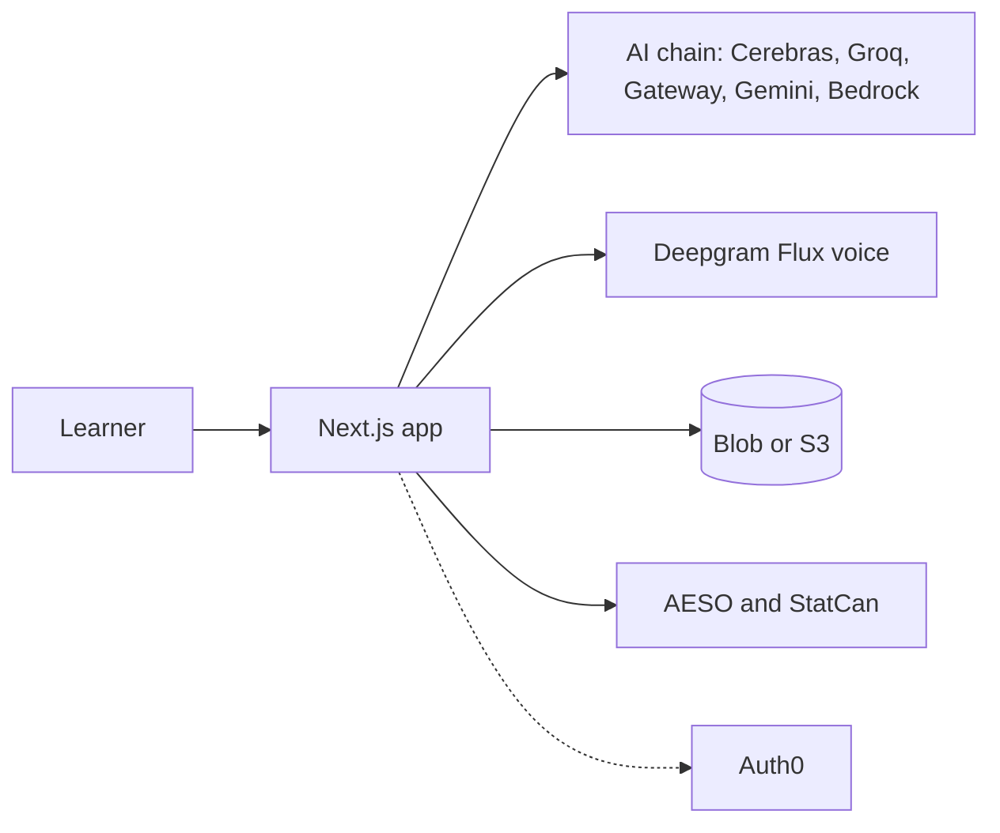

# OryxLearn

**Learn anything. Prove you get it.**

Live: https://oryxlearn.vercel.app

Hack the Change 2026, Prompt 2. For students and curious people: learn a topic, then explain it in your own words and find out honestly whether it landed.

## How it works

1. **Start from anything.** Name a topic, paste a job posting or upload a PDF. A broad goal becomes a **program** of courses, and each course is a map of topics, foundations first.
2. **Pick a topic.** Topics unlock as you prove the ones before them.
3. **Read.** A 3 to 5 minute lesson, plus flashcards and a quiz.
4. **Prove it** in a format that rotates by topic: *Explain it*, *Catch the AI's mistake*, *Explain it to a 10-year-old*, *Say it in 30 seconds*. Finish a course with a **final interview by voice** and earn its badge. You can type or talk hands-free.
5. **Share an evidence page** with a QR code. Anyone can check what you proved, how (typed or spoken, which format), and the quotes behind it, without trusting our AI.

**Together:** start a **study circle**, share its QR code to join, and watch a live feed and a weekly race.
**Habit loop:** a daily streak (one free freeze a week), a combo for proving topics close together, a map that slowly fades until a 60-second quick check relights it, and a topic of the day. Nothing can take a proof away.

## Trust

- **Verified quotes.** The AI points at evidence; code checks each quote really appears in your text (or in the posting or PDF page it cites) and computes the score. The model never scores.
- **Measured grading.** On a 71-case eval, the grader gave the expected verdict on **70 of 71**, passed **0 of 48** answers that should fail, and failed **1 of 23** that should pass. Typical grading time is 0.53 s (0.92 s for the slowest 5%); the whole run cost about $0.15. The labels were written by an AI, not a human expert, and it can still be fooled by a chatbot that states the facts. Details and limits: [docs/eval-results.md](docs/eval-results.md).
- **Delete my data.** One button removes your maps, attempts, evidence pages, circles and more.
- **/trust page.** What we store, what the AI decides, what code checks, and the eval numbers.

## Architecture

- Next.js 16 with feature folders: `src/app` has thin routes, `src/features/<name>` holds the code, `src/shared` holds what two or more features use.
- **AI provider chain:** Cerebras, then Groq, the Vercel AI Gateway, Gemini and AWS Bedrock. Any failure moves to the next route. Model: gpt-oss-120b (Gemini first for flashcards and quiz).
- **Voice:** Deepgram Flux for listening and for the spoken questions.
- **Storage:** Vercel Blob or S3, picked from the environment (memory if neither is set).
- **Sign-in:** optional Auth0. Without it, everyone is a guest.
- **Hosting:** Vercel, plus a container on AWS ECS (`Dockerfile`, `scripts/deploy-aws.sh`).
- **Real data, computed in code:** AESO live grid figures and Statistics Canada labour numbers.



## Run it locally

```bash
npm install --legacy-peer-deps
cp .env.example .env.local   # fill in what you have
npm run dev -- -p 3000
```

Also: `npm test`, `npx tsc --noEmit`, `npm run lint`, `npm run build`, `npm run eval` (real AI calls).

Environment variable names (see `.env.example`): `SESSION_SECRET`, `S3_BUCKET`, `AWS_REGION`, `VERCEL_OIDC_TOKEN`, `BLOB_READ_WRITE_TOKEN`, `CEREBRAS_API_KEY`, `GROQ_API_KEY`, `GEMINI_API_KEY`, `BEDROCK_API_KEY`, `DEEPGRAM_API_KEY`, `ELEVENLABS_API_KEY`, `ELEVENLABS_VOICE_ID`, `PROOF_SEAL_SECRET`, `AUTH0_DOMAIN`, `AUTH0_CLIENT_ID`, `AUTH0_CLIENT_SECRET`, `AUTH0_SECRET`, `APP_BASE_URL`. Most are optional; without AI keys on Vercel the gateway is used, and without voice keys the interview moves to typing.

## Team

Ownership is in [TEAM.md](TEAM.md).

- **Abdu ([VVarrior1](https://github.com/VVarrior1)):** AI chain, skill maps, teach-back and grading, landing, evidence page, AESO and StatCan exercises, study circles, programs, streaks, lessons, the trust page and voice, the shared design system, and deploys.
- **Mirza ([MirzaHB](https://github.com/MirzaHB)):** flashcards, quiz, public courses, sign-in, people matching, dashboard, spaced-repetition review, QR quiz battle, and the Devpost submission text.

## AI disclosure

- **Built with Claude Code** (AI coding agents) directed by both of us. We reviewed, ran and tested the changes. The 71 eval labels were also written by Claude. Full text: [docs/submission/ai-disclosure.md](docs/submission/ai-disclosure.md).
- **AI models at runtime:** gpt-oss-120b through the provider chain above (maps, grading, follow-ups, lessons), Gemini for flashcards and quiz, and Deepgram Flux for voice. Streaks, grid and labour data, matching and spaced repetition use no AI.

## Prior work

OryxLearn is a rebuild, with all-new code, of our earlier OryxLearn project. A judge okayed reusing its features and ideas; no code was copied. New this weekend: the grading method with code-checked quotes and the eval, PDF citations, programs, the Read lessons, the four proving formats and the final interview, voice, study circles, streaks, the evidence page and the /trust page.
