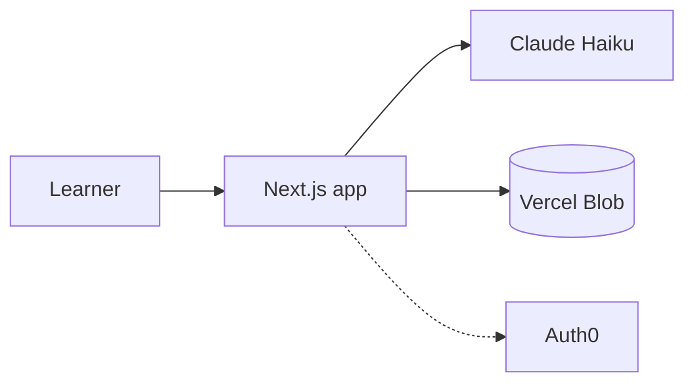

# OryxLearn

**Learn anything. Prove you get it.**

Live: https://oryxlearn.vercel.app

Hack the Change 2026, Prompt 2. For students and curious people: learn a topic, then explain it in your own words and find out honestly whether it landed.

## How it works

1. **Start from anything.** Name a topic, paste a job posting or upload a PDF. A broad subject becomes a **program**, always a four-year degree of 40 courses; a narrow one becomes one course. Each course is a map of topics, foundations first. Maps and programs are private to you.
2. **Shared catalog and pre-test.** A topic course or program is generated once and reused by everyone who asks for the same subject. A topic course offers an optional, skippable pre-test so you do not repeat what you know.
3. **Pick a topic.** Topics unlock as you prove the ones before them.
4. **Read.** A 3 to 5 minute lesson, plus flashcards and a quiz.
5. **Prove it** in a format that rotates by topic: *Explain it*, *Catch the AI's mistake*, *Explain it to a 10-year-old*, *Say it in 30 seconds*. Finish a course with a typed **final interview** and earn its badge.
6. **Share an evidence page** with a QR code. Anyone can check what you proved, how (which format, pasted or not, active time), and the quotes behind it, without trusting our AI.

**Together:** start a **study circle**, share its QR code to join, and watch a live feed and a weekly race.
**Habit loop:** a daily streak (one free freeze a week), a combo for proving topics close together, a map that slowly fades until a 60-second quick check relights it, and a topic of the day. Nothing can take a proof away.

## Trust

- **Verified quotes.** The AI points at evidence; code checks each quote really appears in your text (or in the posting or PDF page it cites) and computes the score. The model never scores.
- **Measured grading.** On a 71-case eval, the grader gave the expected verdict on **70 of 71**, passed **0 of 48** answers that should fail, and failed **1 of 23** that should pass. Typical grading time is 0.53 s (0.92 s for the slowest 5%); the whole run cost about $0.15. The labels were written by an AI, not a human expert, and it can still be fooled by a chatbot that states the facts. Details and limits: [docs/eval-results.md](docs/eval-results.md).
- **Delete my data.** One button removes your maps, attempts, evidence pages, circles and more.
- **/trust page.** What we store, what the AI decides, what code checks, and the eval numbers.

## Architecture

- Next.js 16 with feature folders: `src/app` has thin routes, `src/features/<name>` holds the code, `src/shared` holds what two or more features use.
- **AI:** Claude Haiku only, through the Anthropic SDK, with three thinking profiles (plan, write, check). No fallback model: a failure shows a sentence and a retry.
- **Storage:** Vercel Blob (in-memory locally, when no Blob token is set).
- **Sign-in:** optional Auth0. Without it, everyone is a guest.
- **Hosting:** Vercel. Pushes to `main` deploy.



## Run it locally

```bash
npm install --legacy-peer-deps
cp .env.example .env.local   # fill in what you have
npm run dev -- -p 3000
```

Also: `npm test`, `npx tsc --noEmit`, `npm run lint`, `npm run build`, `npm run eval` (real AI calls).

Environment variable names (see `.env.example`): `SESSION_SECRET`, `BLOB_READ_WRITE_TOKEN`, `ANTHROPIC_API_KEY`, `ANTHROPIC_MODEL`, `PROOF_SEAL_SECRET`, `AUTH0_DOMAIN`, `AUTH0_CLIENT_ID`, `AUTH0_CLIENT_SECRET`, `AUTH0_SECRET`, `APP_BASE_URL`. `ANTHROPIC_API_KEY` is required for AI features. `PROOF_SEAL_SECRET` (`openssl rand -hex 32`, set once on every host) signs each published evidence page; without it pages still publish, but say the server has no seal, so an edit to the store can only be caught by a saved fingerprint.

## AI disclosure

- **Built with Claude Code** (AI coding agents) directed by the owner. We reviewed, ran and tested the changes. The 71 eval labels were also written by Claude.
- **AI models at runtime:** Claude Haiku for everything written or graded (programs, syllabi, maps, lessons, quiz, flashcards, grading, follow-ups). Streaks, matching and spaced repetition use no AI.

## Prior work

OryxLearn is a rebuild, with all-new code, of our earlier OryxLearn project. A judge okayed reusing its features and ideas; no code was copied. New this weekend: the grading method with code-checked quotes and the eval, PDF citations, programs, the Read lessons, the four proving formats and the final interview, study circles, streaks, the evidence page and the /trust page.
